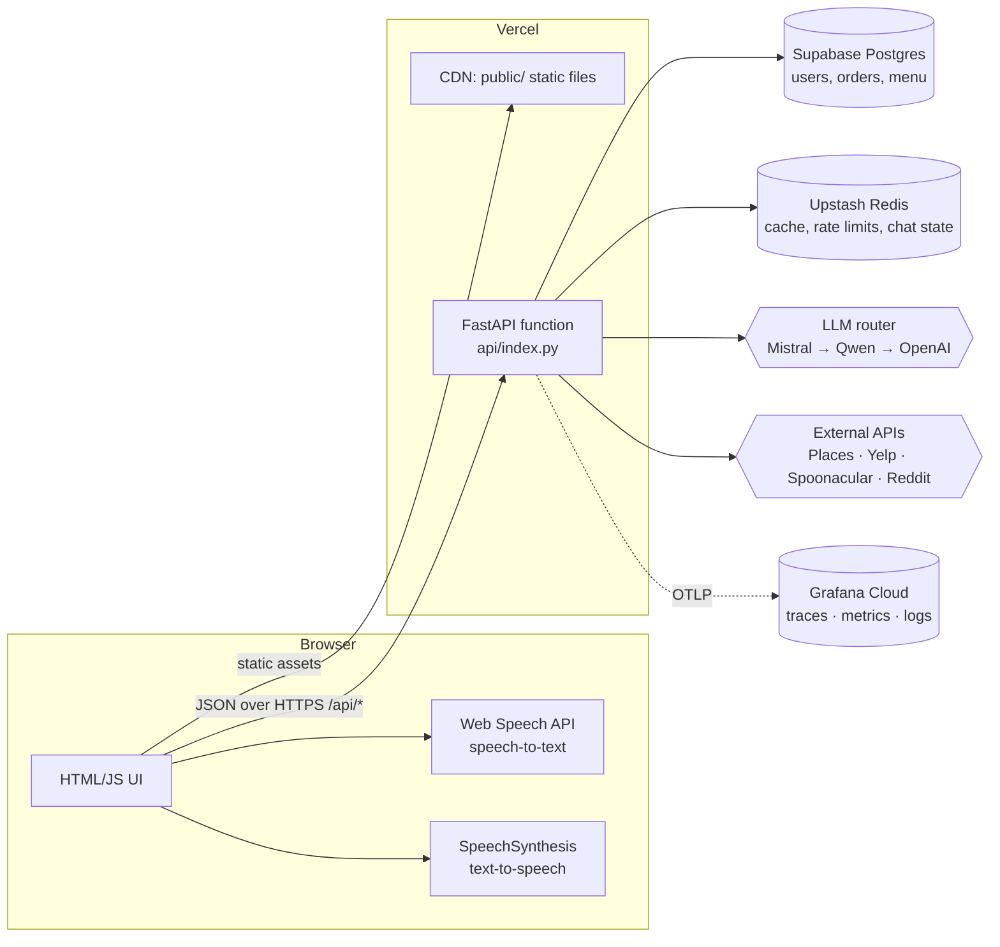
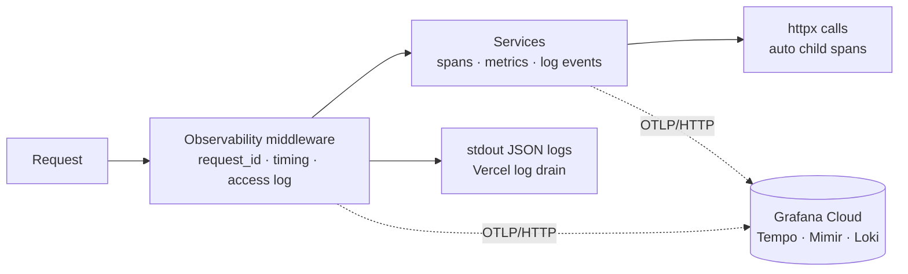

# Architecture: Voice-Based Food Ordering Chatbot

> Status legend used throughout: ✅ built and tested, 🔜 planned (batch number shown), 💡 design decision still open.
> This document is the reference for *why* the project is shaped the way it is. `progress.md` tracks *what is done*.

---

## 1. Goals and constraints

| Goal | What it means in practice |
|---|---|
| Voice-first ordering | User speaks, bot understands, builds a cart, confirms, places the order. Text is always available as a fallback. |
| Low latency | Target: first spoken reply within ~1.5 s of the user finishing a sentence. Browser-side speech recognition, cache-first data access, streaming replies, regional co-location. |
| Low token cost | Free-tier LLMs have tight limits. The LLM is used for *understanding and choosing actions*, not for carrying data around. |
| Personalised | Saved addresses, diet, allergies, cuisines, order history feed a recommendation engine. |
| Survives peaks | IPL-night traffic spikes must degrade gracefully, not fall over. |
| Observable | Every request, LLM call and external API call is traceable; logs, metrics and traces correlate. |
| Free-tier deployable | Vercel (compute + CDN), Supabase (Postgres), Upstash (Redis cache), Grafana Cloud (telemetry). |

Hard constraints that shape the design:

- **Vercel runs the backend as a serverless function.** Memory does not persist reliably between requests, so anything that must be shared (cache, rate-limit counters, conversation state) lives in Redis or Postgres, never in a Python global.
- **Supabase's pooled connection (PgBouncer, transaction mode) does not support prepared statements.** The async driver must be configured accordingly (see §7).
- **Function bundle size is limited.** No heavyweight ML libraries (scikit-learn, torch). The recommender is a lightweight, explainable scoring model.
- **No payments for now. English only.**

---

## 2. System overview



**Why speech runs in the browser:** the browser's built-in recognizer streams partial results while the user is still talking and costs nothing. Doing STT server-side would add an audio upload, a model call and a cold-start penalty to every utterance. Trade-off: it works in Chrome, Edge and Safari but not Firefox, so text input is a first-class fallback, not an afterthought.

---

## 3. Project structure

```
voice-food-bot/
├── api/                         # Everything that runs on the server
│   ├── index.py                 ✅ App entrypoint (Vercel looks for this file)
│   ├── routes/                  🔜 HTTP layer: auth, profile, menu, cart, orders, chat, recommend
│   ├── services/                🔜 Business logic: auth, chat orchestration, recommender, menu ingestion
│   │   └── clients/             🔜 External API clients: places, yelp, spoonacular, reddit, llm router
│   ├── models/                  🔜 SQLAlchemy ORM models (database tables as Python classes)
│   ├── schemas/                 🔜 Pydantic request/response shapes (the API contract)
│   ├── middleware/              🔜 Request ID, rate limiting, security headers (moved out of index.py)
│   ├── templates/               🔜 Jinja2 server-rendered fragments (order confirmation, emails)
│   └── deps.py                  🔜 FastAPI dependencies: current user, DB session
│
├── config/
│   └── settings.py              ✅ Typed settings from environment variables
│
├── database/                    🔜 Everything about talking to Postgres
│   ├── engine.py                🔜 Async engine + session factory (pooler-safe settings)
│   ├── repositories/            🔜 Data-access functions (queries live here, not in services)
│   ├── schema.sql               🔜 Canonical table definitions to run in Supabase
│   └── seed/                    🔜 Menu import scripts
│
├── logger/                      # Observability
│   ├── logging_config.py        ✅ Structured JSON logs, request/trace correlation, redaction
│   └── telemetry.py             ✅ OpenTelemetry traces + metrics + log export, metric catalogue
│
├── prompt_lib/                  🔜 Versioned prompts and tool definitions for the LLM
│   ├── system/                  🔜 System prompt templates (kept small on purpose)
│   ├── tools.py                 🔜 JSON schemas of the tools the LLM may call
│   └── loader.py                🔜 Loads and renders templates
│
├── utils/                       🔜 Small framework-free helpers
│   ├── security.py              🔜 Password hashing, JWT create/verify
│   ├── cache.py                 🔜 Redis cache with in-process L1, single-flight
│   └── resilience.py            🔜 Retry, timeout budget, circuit breaker
│
├── public/                      🔜 Static frontend served by Vercel's CDN
│   ├── index.html, login.html, signup.html, dashboard.html
│   ├── css/styles.css
│   └── js/                      api.js, auth.js, dashboard.js, chat.js, voice.js
│
├── tests/                       🔜 pytest suites mirroring the folders above
├── .env.example  ✅  .env (local, git-ignored) ✅  .gitignore ✅  requirements.txt ✅
├── architecture.md ✅  README.md ✅  progress.md ✅
```

### A deliberate deviation: where static files live

You asked for `static` and `templates` inside `api/`. `templates/` is there as requested. **`static` is `public/` at the repo root instead**, because Vercel's CDN only serves `public/**` and explicitly advises against mounting static files in FastAPI. Serving from the CDN is faster, free of function invocations, and survives traffic spikes without costing compute. Locally, `api/index.py` mounts `public/` itself so the experience is identical. If you strongly prefer `api/static/`, it works but every asset request would hit the function.

### Why `api/` can hold the whole backend

Vercel treats each `.py` file in an `/api` folder as its own function **unless** a Python framework preset (FastAPI) is detected, in which case the whole app is one function and files under `/api` do not become separate functions. Detection is based on `fastapi` in `requirements.txt` plus a recognised entrypoint (`api/index.py`). This is confirmed in Vercel's docs but should be re-confirmed on the first real deploy (listed in `progress.md`).

---

## 4. Layering rules

```
routes  →  services  →  repositories  →  models / database
  ↑            ↑
schemas    clients (LLM, external APIs), utils, prompt_lib
```

| Layer | Allowed to | Must not |
|---|---|---|
| **routes** | Parse/validate input (via schemas), call one service, shape the HTTP response, set cookies | Contain business logic or SQL |
| **services** | Hold business rules, orchestrate repositories and clients, emit logs/metrics/spans | Import FastAPI or know about HTTP |
| **repositories** | Run queries, return model objects | Make business decisions |
| **models** | Describe tables and relationships | Contain behaviour beyond simple helpers |
| **schemas** | Define what the API accepts and returns | Expose password hashes or internal IDs unnecessarily |
| **clients** | Talk to one external system, with timeout, retry, cache, circuit breaker, metrics | Know about users or carts |

**Why this matters:** a service that does not know about HTTP can be tested without a server, reused by a cron job, and swapped behind a different interface (for example, a future mobile app). Models are not schemas because the database shape and the API shape change for different reasons.

---

## 5. Folder-by-folder responsibilities

### `api/index.py` ✅
Builds the FastAPI app, installs the observability middleware and the global error handler, registers routers (placeholder marker present), turns on OpenTelemetry instrumentation, and (locally only) mounts `public/`. Order matters: telemetry instrumentation is added *after* middleware so the trace span wraps our middleware, and the static catch-all mount is registered *last* so it never shadows API routes.

### `config/settings.py` ✅
The single reader of environment variables. Typed with Pydantic, so `"false"` becomes `False` and bad values fail at startup. Fails fast in production if `JWT_SECRET` is weak. Exposes `configured_services` (booleans only) for the health endpoint.

### `logger/` ✅
See §12. Two files: logging format and correlation, and OpenTelemetry wiring plus the metric catalogue.

### `database/` 🔜 Batch 3
Async SQLAlchemy engine configured for Supabase's pooler. Repositories hold queries. `schema.sql` is the source of truth you paste into Supabase's SQL editor (we avoid running migrations from a serverless function).

### `prompt_lib/` 🔜 Batch 11
Prompts are code. Keeping them in one folder, versioned (`system/v1.md`), lets us A/B test and roll back without hunting through services. Also holds the tool (function-calling) JSON schemas, so the contract between the LLM and our services is visible in one place.

### `utils/` 🔜
Small, dependency-light helpers used everywhere: password hashing and JWT, the two-level cache, retry/timeout/circuit-breaker primitives.

---

## 6. Request lifecycle: one spoken order

Example utterance: *"Add two paneer tikka rolls and something sweet, deliver to home."*

1. **Browser:** Web Speech API produces interim text, then a final transcript. The UI shows it live and sends the final text the moment recognition ends (no waiting for a button).
2. **`POST /api/chat`** with `{message, input_mode: "voice"}`; session cookie authenticates.
3. **Middleware:** assign `request_id`, open the trace span, check rate limits (Redis), start timing.
4. **Chat service:**
   1. *Fast path:* simple commands ("confirm", "remove the roll", "show cart") are matched by rules and **skip the LLM entirely**.
   2. *Context build:* load compact state from Redis (cart, chosen address ID, last few turns, running summary); load the user's preference snapshot (cached).
   3. *LLM call* through the provider router with a small system prompt, the compact state, and tool schemas.
   4. *Tool loop:* the model asks for `search_menu`, `add_to_cart`, `recommend_dessert`, `set_address`. Our code executes each tool, returns **trimmed** results (IDs, names, prices), and the model composes the reply. Independent tools run in parallel.
5. **Response:** reply text, updated cart, optional UI hints. Streamed so TTS can begin on the first sentence.
6. **Browser:** SpeechSynthesis reads the reply; UI updates the cart.
7. **After response:** a fire-and-forget flush pushes buffered telemetry (on Vercel). Structured log lines, spans and metrics for the whole turn share one `trace_id`.

**Order placement is special:** the bot always reads back the cart and address and requires an explicit "yes" before calling `place_order`. The call carries an **idempotency key** so a retry on a flaky network cannot create two orders.

---

## 7. Data architecture

### 7.1 Where each kind of data lives

| Data | Store | Why |
|---|---|---|
| Users, addresses, preferences, orders, order items, menu, restaurants | **Postgres (Supabase)** | Durable, relational, queryable |
| Chat working state (cart draft, last turns, summary) | **Redis**, TTL ~1-2 h | Fast, disposable, shared across serverless instances |
| External API responses (places, menus, ratings, Reddit sentiment) | **Redis**, TTL by volatility | Saves quota and latency |
| Hot lookups inside one instance (menu index, config) | **In-process LRU** | Zero network cost; safe because it is only a *cache* |
| Rate-limit counters, circuit-breaker state | **Redis** | Must be global, not per instance |

### 7.2 Planned tables (Batch 3)

`users`, `addresses` (many per user, one default), `user_preferences` (diet, allergies, cuisines, spice level, budget), `restaurants`, `menu_items`, `orders`, `order_items`, `chat_sessions` (optional, only if we persist history), `idempotency_keys`.

Security note: **enable Row Level Security on every table with no policies.** Supabase auto-exposes tables through a public REST API; RLS-without-policies makes that API return nothing, while our backend (which connects directly with the database role) is unaffected. This is defence in depth.

### 7.3 Connecting to Supabase from serverless

- Use the **transaction pooler** URL (port 6543).
- Async driver `asyncpg` with `statement_cache_size=0` (PgBouncer in transaction mode cannot handle prepared statements).
- Small pool per instance (or `NullPool`), because many instances × big pools exhaust the database.
- Pick the Supabase region nearest users (Mumbai `ap-south-1` for India) and pin the Vercel function region to match (Mumbai `bom1`), so DB round trips stay in single-digit milliseconds.

### 7.4 Cache key conventions

`{namespace}:{version}:{normalized-args-hash}`: for example `places:v1:pune:biryani`. Version in the key lets us invalidate by bumping a number. Normalise inputs (lowercase, trim, sort) so equivalent queries share a key.

---

## 8. LLM strategy

### 8.1 Provider chain with fallback 🔜 Batch 11
Mistral (free tier) → Qwen via OpenRouter (free model) → OpenAI as last resort. All three speak the OpenAI-compatible chat/tools protocol, so **one client class with a different `base_url`, key and model** covers them. Each provider has a circuit breaker: after N consecutive failures or rate-limit responses it is skipped for a cool-down. Every attempt emits `foodbot.llm.requests{provider,model,outcome}`; any answer from a non-primary provider increments `foodbot.llm.fallbacks`.

Free-tier model names and limits change often. They are environment variables (`MISTRAL_MODEL`, `QWEN_MODEL`, `OPENAI_MODEL`) precisely so they can be changed without a deploy.

### 8.2 Token-saving techniques

| Technique | Effect |
|---|---|
| **Rule-based fast path** for trivial commands | Zero tokens for a large share of turns |
| **Tool-first design**: the model picks tools, code fetches data | Menu data never enters the prompt wholesale |
| **Trimmed tool results**: IDs, names, price, tags only | Tool output is the biggest hidden token cost |
| **Compact state JSON** instead of full chat history | Constant-size context regardless of conversation length |
| **Rolling summary** of older turns | Long sessions stay cheap |
| **Small, static system prompt** at the front | Maximises provider-side prompt caching where offered |
| **Model tiering**: small model for extraction, larger for multi-constraint requests | Pay for reasoning only when needed |
| **`max_tokens` caps and JSON-only outputs** | Predictable cost and latency |
| **Response cache** for normalised identical queries | Repeated "best biryani near me" costs nothing |

### 8.3 `prompt_lib` layout 🔜
```
prompt_lib/
├── system/v1.md          # persona, rules, safety (allergies!), confirmation requirement
├── system/summarizer.md  # prompt for compressing older turns
├── tools.py              # tool JSON schemas: search_menu, add_to_cart, remove_item, view_cart,
│                         #   set_address, recommend, place_order
└── loader.py             # render with Jinja2, enforce a token budget in tests
```

---

## 9. Recommendation engine 🔜 Batch 12

A transparent weighted scorer, not a heavy ML model (bundle limit, cold-start users, explainability):

```
score(item, user, context) =
    w1 * preference_match      # cuisine, diet, spice vs saved preferences
  + w2 * history_affinity     # reorder frequency, similarity to past orders (tag overlap)
  + w3 * quality_signal       # Yelp/Google rating, normalised, with review-count confidence
  + w4 * community_buzz       # Reddit mention sentiment (cached, lowest priority)
  + w5 * context_fit          # time of day, weather, event night ("IPL snacks")
  - penalty(allergens, disliked, over_budget)   # hard filters happen BEFORE scoring
```

- **Hard constraints first:** allergens and dietary rules *filter* items out; they are never a soft score.
- **Cold start:** with no history, weights shift toward preferences and quality signals.
- **Explainability:** each result carries its top reasons ("matches your vegetarian preference, 4.5★"), which the bot can speak.
- **Learning loop (later):** log impressions and orders (`foodbot.recommendations.served`, order events) and fit the weights offline from this data. A pgvector-based similarity feature is a possible later upgrade.

---

## 10. External APIs and resilience

| API | Used for | Notes |
|---|---|---|
| Google Places | Nearby real restaurants, hours, ratings | Quota/billing sensitive: cache hard (hours-long TTL) |
| Yelp Fusion | Ratings, review counts, categories | Daily call limits on free plans |
| Spoonacular | Menu items and nutrition data | Points-based free quota |
| Reddit | Community sentiment for "best of" signals | Lowest priority; first feature to shed under load |

Free-tier quotas and terms change, so confirm each provider's current limits before relying on them.

**Every client gets the same protection** (in `utils/resilience.py`, applied in `api/services/clients/`):
1. Per-call **timeout** (short; slow data is worse than no data).
2. **Retry with jitter** for transient errors only (never for 4xx).
3. **Circuit breaker** (state in Redis) so a dead API stops being called.
4. **Cache** (with *stale-while-error*: serve an old answer if the live call fails).
5. **Single-flight**: concurrent identical requests share one upstream call.
6. **Metrics and spans** (`foodbot.external_api.duration/errors`; outbound `httpx` calls are auto-traced).

**Menu source (open 💡):** no free API offers real local-restaurant menus, and scraping delivery apps conflicts with their terms. Proposal: Spoonacular menu items + TheMealDB for dish data, with Places/Yelp supplying real nearby restaurants. To be confirmed before Batch 10.

---

## 11. Peak-load playbook (IPL nights)

Traffic during a match is bursty and predictable (innings breaks, final overs). Defence in layers:

1. **CDN absorbs static load.** HTML/JS/CSS never touch the function.
2. **Three-level cache:** in-process LRU → Redis → source. Pre-warm popular queries before the toss (scheduled job).
3. **Single-flight and request coalescing** so a thousand identical "popular snacks" calls make one upstream call.
4. **Rate limiting** per user and per IP (sliding window in Redis); rejections are metered (`foodbot.rate_limit.rejections`).
5. **Priority-based load shedding.** When latency or error budgets are breached, switch off in this order: Reddit sentiment → live Places lookups (serve cached) → LLM "complex" tier (use small model) → recommendations (serve popular defaults). Ordering and cart stay alive to the end. Controlled by a feature-flag key in Redis, no deploy needed.
6. **Time budgets:** a whole chat turn has an overall deadline (for example 6 s); each dependency gets a slice. When the budget is spent, return the best available answer.
7. **Connection hygiene:** transaction pooler, small pools, no connection held across an LLM call.
8. **Idempotent writes:** order placement uses idempotency keys so client retries during slowness cannot double-order.
9. **Observability under load:** lower `OTEL_TRACE_SAMPLE_RATIO` (for example 0.2) to protect free-tier quotas, while metrics (cheap, aggregated) stay at full fidelity.
10. **Proof:** a load test (Locust or k6) in Batch 14 simulating the spike shape, run *before* the first big match. Free tiers have hard ceilings; know where they are.

---

## 12. Observability ✅

### 12.1 Three signals, one thread

| Signal | Answers | Implementation |
|---|---|---|
| **Traces** | "Where did this one slow request spend its time?" | OpenTelemetry spans: inbound request (auto), outbound `httpx` calls (auto), custom spans in services |
| **Metrics** | "Is the system healthy right now, and how is it trending?" | OpenTelemetry metrics: HTTP RED metrics (auto) + the catalogue below |
| **Logs** | "What exactly happened?" | Structured JSON to stdout, also exported over OTLP |

The thread tying them together is `trace_id`: every log line emitted during a request carries it, so in Grafana you can jump from a slow-span to the exact log lines, and from an error log to its full trace. `request_id` is also returned to the client in the `X-Request-ID` header (and in 500 response bodies), so a user can quote it in a bug report.



### 12.2 What is logged

Every log line is one JSON object:

| Field | Meaning |
|---|---|
| `ts`, `level`, `logger`, `msg` | When, severity, which module, short event name |
| `service`, `env`, `version` | Which deployment produced it |
| `event` | Stable machine-readable event name for filtering |
| `request_id`, `user_id` | Correlation and attribution (set from context, automatic) |
| `trace_id`, `span_id` | Link to the trace (automatic when telemetry is on) |
| any `extra={...}` fields | Searchable business fields (`order_id`, `provider`, `duration_ms`) |
| `exception` | Full stack trace on errors |

Event catalogue (implemented ✅ / planned 🔜):

| Event | Status |
|---|---|
| `app_starting`, `app_stopping`, `http_request`, `unhandled_exception` | ✅ |
| `auth.signup`, `auth.login`, `auth.login_failed`, `auth.logout` | 🔜 Batch 4 |
| `llm.call`, `llm.fallback`, `external_api.call`, `cache.error` | 🔜 Batches 9, 11 |
| `chat.turn`, `order.placed`, `rate_limit.rejected`, `circuit.opened` | 🔜 Batches 6, 10, 13 |

Access-log level reflects outcome: 5xx → `ERROR`, 4xx → `WARNING`, success → `INFO`, health checks → `DEBUG` (so uptime pings do not flood logs).

### 12.3 Privacy and safety rules (enforced in code)

- A **redaction filter** replaces values of keys that look like secrets (`password`, `token`, `api_key`, `authorization`, `cookie`, `jwt`, `secret`, `credential`) with `[redacted]`, including inside nested dicts. Verified by test.
- Keys holding personal data (`email`, `phone`, `address`, `street`, `transcript`, `utterance`) become `[pii]`. **We log that a voice turn happened and how long it took, not what the user said.**
- Query strings are never logged (they can carry personal data); only the path.
- Metric labels are low-cardinality only: provider, model, outcome, service. Never `user_id`, `request_id` or free text (these explode metric storage costs).

### 12.4 Metric catalogue

Defined once in `logger/telemetry.py` (class `Metrics`) so names never drift. Use: `get_metrics().orders_placed.add(1)`.

| Metric | Type | Labels | Purpose |
|---|---|---|---|
| `foodbot.llm.requests` | counter | provider, model, outcome | LLM success/failure rates |
| `foodbot.llm.tokens` | counter | provider, model, direction | Token spend vs free-tier limits |
| `foodbot.llm.duration` | histogram (ms) | provider, model | LLM latency percentiles |
| `foodbot.llm.fallbacks` | counter | from, to | Health of the primary provider |
| `foodbot.external_api.duration` | histogram (ms) | service, outcome | Third-party latency |
| `foodbot.external_api.errors` | counter | service, error_type | Third-party reliability |
| `foodbot.cache.operations` | counter | namespace, result | Cache hit rate |
| `foodbot.rate_limit.rejections` | counter | route | Abuse / overload signal |
| `foodbot.circuit_breaker.opened` | counter | dependency | Dependency outages |
| `foodbot.orders.placed` | counter | none | Business throughput |
| `foodbot.chat.turns` | counter | input_mode | Voice vs text usage |
| `foodbot.auth.events` | counter | event | Sign-up and login health |
| `foodbot.recommendations.served` | counter | strategy | Recommender usage |

Plus automatic HTTP metrics (request duration, response size, active requests) from the FastAPI instrumentation. Exact metric names in Prometheus/Mimir depend on the backend's naming conversion (dots become underscores, units are appended), so check the Grafana metric browser after the first export.

### 12.5 Serverless-specific design

- **Short batch delays (2 s)** on span and log exporters, because serverless instances are short-lived.
- **Best-effort flush after each request** on Vercel: `schedule_flush()` runs on a worker thread so the user's response is not delayed. Shutdown also flushes.
- **Telemetry can never break the app.** Setup is wrapped in error handling; an unreachable backend produces warnings, not failures (tested: with the receiver down, requests and error handling stayed correct).
- **Head sampling** (`OTEL_TRACE_SAMPLE_RATIO`) controls trace volume. It cannot "always keep errors"; tail-based sampling would need a Collector/Alloy later. Logs and metrics are unaffected by trace sampling.
- **No log-exporter feedback loop:** the exporter's own logs are filtered out of the log export.

### 12.6 Hooking up Grafana Cloud (when you are ready)

1. Create a free Grafana Cloud stack.
2. Open the stack's OpenTelemetry/OTLP connection page to get the **OTLP endpoint**, your **instance ID** and to create an **access token** with write scopes for traces, metrics and logs.
3. Compute `base64("<instanceId>:<token>")`.
4. Set (locally in `.env`, and in Vercel's environment variables):
   ```
   OTEL_ENABLED=true
   OTEL_EXPORTER_OTLP_ENDPOINT=<the OTLP base URL, no /v1/... suffix>
   OTEL_EXPORTER_OTLP_HEADERS=Authorization=Basic%20<base64>
   ```
5. Start the app, hit a few endpoints, then look in Explore for traces (Tempo), metrics (Mimir) and logs (Loki).

Any other OTLP backend works the same way by changing these values.

### 12.7 Suggested dashboards and alerts 🔜 Batch 11

Dashboards: (1) **Service health**: request rate, error rate, p50/p95/p99 latency by route. (2) **LLM**: tokens per minute vs limits, p95 latency and error rate per provider, fallback ratio. (3) **Dependencies**: external API latency/errors, cache hit ratio, circuit-breaker trips. (4) **Product funnel**: chat turns → carts → orders, voice vs text. (5) **Peak mode**: rate-limit rejections, shed features, saturation.

Alerts (starting points): 5xx rate above 2% for 5 min; p95 latency above 2 s for 10 min; LLM fallback ratio above 30%; any circuit breaker open for more than 5 min; zero orders for 30 min during peak hours.

---

## 13. Security

- **Passwords:** bcrypt hashing; never logged, never returned.
- **Sessions:** JWT in an **httpOnly, SameSite=Lax, Secure** cookie (JavaScript cannot read it, which blunts XSS token theft). Expiry via `JWT_EXPIRE_MINUTES`.
- **CSRF:** SameSite plus an Origin check on state-changing requests.
- **Input validation:** Pydantic schemas on every route; length limits on chat text.
- **Authorization:** every query that touches user data is scoped by the authenticated user's ID (no IDs trusted from the client alone).
- **Secrets:** environment variables only; `.env` git-ignored; production refuses to boot with a weak `JWT_SECRET`.
- **Supabase RLS** on all tables (see §7.2).
- **Rate limiting** on login, sign-up and chat endpoints.
- **Error responses** never leak internals; details go to logs keyed by `request_id`.
- **Allergy safety:** allergens are hard filters in code and restated by the bot before order confirmation. The LLM is never the only safeguard.

---

## 14. Configuration and environments

| Env | `APP_ENV` | Logs | Telemetry | Notes |
|---|---|---|---|---|
| Local | `development` | Readable console | Off (or console export) | `.env` file; docs at `/api/docs` |
| Production (Vercel) | `production` | JSON | On, sample ratio tuned | Env vars in Vercel dashboard; docs hidden; strict secret check |

Settings flow: environment → `config/settings.py` → imported everywhere. No other module reads `os.environ`.

---

## 15. Testing strategy 🔜

- **Unit:** services with fake repositories/clients; recommender scoring; prompt budget tests (system prompt stays under N tokens); redaction.
- **API:** FastAPI `TestClient` against a test database for auth, profile, cart, orders.
- **LLM layer:** a fake provider that scripts tool calls, so chat flows are deterministic; fallback tests by failing providers on purpose.
- **Resilience:** simulate slow/failing external APIs; verify timeouts, breakers, stale-while-error.
- **Observability:** verified so far by running the app against a fake OTLP receiver that decodes what arrives (spans, custom metrics, correlated logs, auth header).
- **Load:** Locust/k6 scenario shaped like an IPL break (Batch 14).
- **Manual voice checklist:** Chrome, Edge, Safari; mic denied; noisy input; no-speech timeout.

---

## 16. Deployment topology

| Component | Service | Notes |
|---|---|---|
| Frontend static assets | Vercel CDN (`public/`) | Free, global |
| Backend | Vercel Function (FastAPI, Python runtime) | Pin region to Mumbai (`bom1`); env vars in dashboard |
| Database | Supabase Postgres | Mumbai region; transaction-pooler URL |
| Cache / rate limits / chat state | Upstash Redis (REST) | Works from serverless without persistent connections |
| Telemetry | Grafana Cloud (OTLP) | Free tier; verify current limits |
| Scheduled jobs (cache pre-warm) | Vercel Cron | Planned for peak-hour preparation |

---

## 17. Build roadmap (5 files per batch)

| Batch | Scope | Status |
|---|---|---|
| 1 | Foundation: requirements, .gitignore, .env.example, config, entrypoint | ✅ |
| 2 | Structure, docs, `.env`, logging + OpenTelemetry | ✅ |
| 3 | Database: engine, schema.sql, ORM models | 🔜 |
| 4 | Security + auth: hashing/JWT, schemas, deps, auth service and routes | 🔜 |
| 5 | Profile: addresses and preferences (service, routes, schemas) | 🔜 |
| 6 | Middleware extraction, rate limiting, cache, resilience utils | 🔜 |
| 7-8 | Frontend: shell and pages, then JS logic | 🔜 |
| 9 | External API clients | 🔜 |
| 10 | Menu ingestion, cart, orders | 🔜 |
| 11 | LLM router, prompt_lib, dashboards and alerts | 🔜 |
| 12 | Recommendation engine | 🔜 |
| 13 | Chat endpoint and voice UI | 🔜 |
| 14 | Peak-load hardening and load test | 🔜 |
| 15 | Deployment, README polish, smoke tests | 🔜 |

---

## 18. Decisions and open items

**Decided:** Vercel + Supabase; FastAPI; plain HTML/CSS/JS; browser STT/TTS; free LLMs (Mistral, Qwen) with OpenAI fallback; Upstash Redis cache; OpenTelemetry to an OTLP backend (Grafana Cloud as the target); no payments; English only; `public/` for static files.

**Open:**
1. 💡 Menu source: Spoonacular + TheMealDB (proposed) vs another source.
2. 💡 Auth: own email/password + JWT cookie (proposed) vs Supabase Auth.
3. 💡 Whether to persist chat history in Postgres or keep it only as short-lived Redis state (privacy vs analytics).
4. Verify on first deploy: Vercel entrypoint detection at `api/index.py`; current free-tier limits of each provider.
